# Interactive 3D Pinball Game

### The Game Hub — Neon Circuit Pinball & Technology Gaming Lounge

A **C++17 / OpenGL 3.3** computer graphics project combining a playable pinball machine with an interactive 3D gaming lounge. Launch the ball, operate the flippers, complete the target bank, and explore a room with controllable lights, a rotating fan, an animated refrigerator door, three raster shading modes, and CPU ray tracing.

[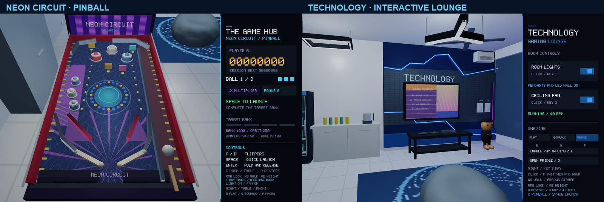](docs/screenshots/project-overview.png)

**[Demo videos](#demo-videos)** · **[Quick start](#quick-start)** · **[Feature gallery](#feature-gallery)** · **[Controls](#controls)** · **[Scoring](#scoring-and-game-flow)** · **[Graphics](#graphics-implementation)** · **[Tests](#build-and-test)** · **[Reports](#project-reports)**

## Demo videos

The full video is the supplied screen recording, converted to H.264 MP4 with its original duration preserved. Click the animated preview or a **Watch** link to open a video; the **File** links provide the repository copy.

[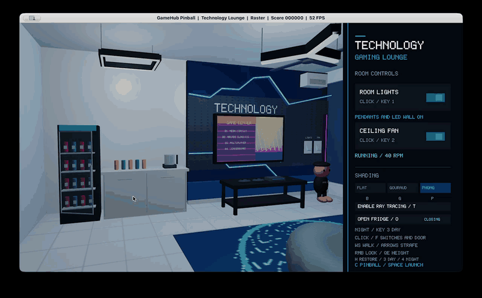](https://raw.githubusercontent.com/nahianzarif1/PinballGame_Computer_Graphics/main/docs/media/full-demo.mp4)

| Video | Duration | What it shows | Links |
| --- | --- | --- | --- |
| Full project recording | 2 min 15 sec | Room view, camera movement, launches, flipper play, live scoring, and restart | [Watch](https://raw.githubusercontent.com/nahianzarif1/PinballGame_Computer_Graphics/main/docs/media/full-demo.mp4) · [File](docs/media/full-demo.mp4) |
| Gameplay excerpt | 28 sec | A ball in play, bumper/target scoring, and flipper interaction | [Watch](https://raw.githubusercontent.com/nahianzarif1/PinballGame_Computer_Graphics/main/docs/media/gameplay-demo.mp4) · [File](docs/media/gameplay-demo.mp4) |
| Room camera excerpt | 18 sec | Lounge geometry, rotating ceiling fan, and camera navigation | [Watch](https://raw.githubusercontent.com/nahianzarif1/PinballGame_Computer_Graphics/main/docs/media/room-tour.mp4) · [File](docs/media/room-tour.mp4) |

The fan and refrigerator animations below were captured separately from the game to show their behavior clearly. [Media sources and capture details](docs/MEDIA_GUIDE.md).

## Quick start

### Requirements

| Dependency | Purpose |
| --- | --- |
| C++17 compiler | Compile the application and test suites |
| CMake 3.10 or later | Configure and build the project |
| GLFW 3 | Create the window and handle keyboard/mouse input |
| GLM | Vectors, matrices, quaternions, and camera mathematics |
| OpenGL 3.3 core support | Raster rendering and ray-image presentation |
| GLAD | OpenGL loader; included in `external/glad/` |

The Release build and all three regression suites have been verified on macOS. A graphics session is required to run the game; the tests do not open a window.

### Build on macOS

Install the external dependencies with Homebrew, then clone and build:

```bash
brew install cmake glfw glm

git clone https://github.com/nahianzarif1/PinballGame_Computer_Graphics.git
cd PinballGame_Computer_Graphics

cmake -S . -B build -DCMAKE_BUILD_TYPE=Release -DBUILD_TESTING=ON
cmake --build build --parallel 4
ctest --test-dir build --output-on-failure
./build/GameHubPinball
```

After dependencies are installed, you can also double-click **[Launch Game.command](Launch%20Game.command)** on macOS. It configures the project, builds the game, and launches it. On other platforms, install equivalent CMake, GLFW, GLM, and OpenGL development packages before using the CMake commands; those platforms have not been validated in this project.

### First play session

1. The game opens in the Technology lounge. Press **C** to switch to the pinball table.
2. Press **Space** for a quick launch, or hold **Enter** to charge the plunger and release it to launch.
3. Use **A** and **D** to operate the left and right flippers.
4. Watch the console for score, target progress, multiplier, bonus, remaining balls, and ball-save time.
5. Press **R** after game over to start a new game. Press **C** to return to the room, or **H** to restore the reference room camera.

Space and Enter switch to the table when launching a waiting ball from the room. Space does not move or reset a ball that is already playing.

## Feature gallery

These screenshots are rendered from the application at **1600 × 1000**. Gameplay state examples use the same collision and game-state APIs exercised by the regression tests. Click a screenshot to inspect it at full size.

### 1. Playable pinball table and live console

The table contains a shooter lane, charged plunger, two flippers, pop bumpers, four drop targets, slingshots, an orbit lane, guide rails, a central reactor design, illuminated inserts, and themed backglass. The console updates score and game state during play.

| Ready to launch | Ball in play |
| --- | --- |
| [](docs/screenshots/table-ready.png) | [](docs/screenshots/active-gameplay.png) |

### 2. Charged launch and powered flippers

Holding **Enter** pulls the plunger; releasing it launches the ball. **A / D** animate the flippers and transfer contact velocity to the ball. Physics uses a fixed **240 Hz** step so contacts remain consistent across different rendering frame rates.

| Charged plunger | Both flippers powered |
| --- | --- |
| [](docs/screenshots/plunger-charged.png) | [](docs/screenshots/flippers-powered.png) |

### 3. Bumper hits, drop targets, and multipliers

Bumpers flash when hit and award points with contact cooldowns. Completing all four drop targets awards the bank reward, raises the multiplier, and resets the bank after its completion animation. The captured bank completion shows **1,400 points**, a **2× multiplier**, and **400 pending drain bonus**.

| Bumper impact | Completed target bank |
| --- | --- |
| [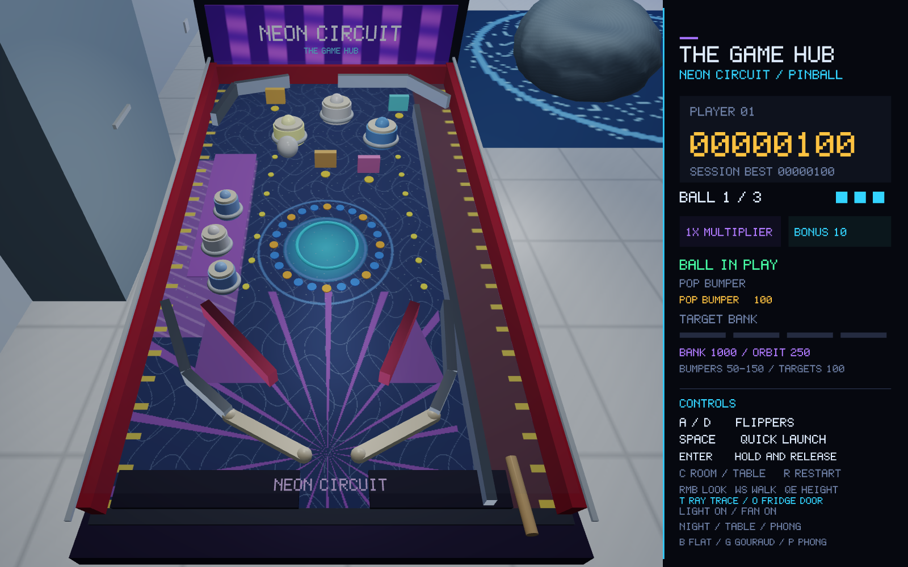](docs/screenshots/bumper-hit.png) | [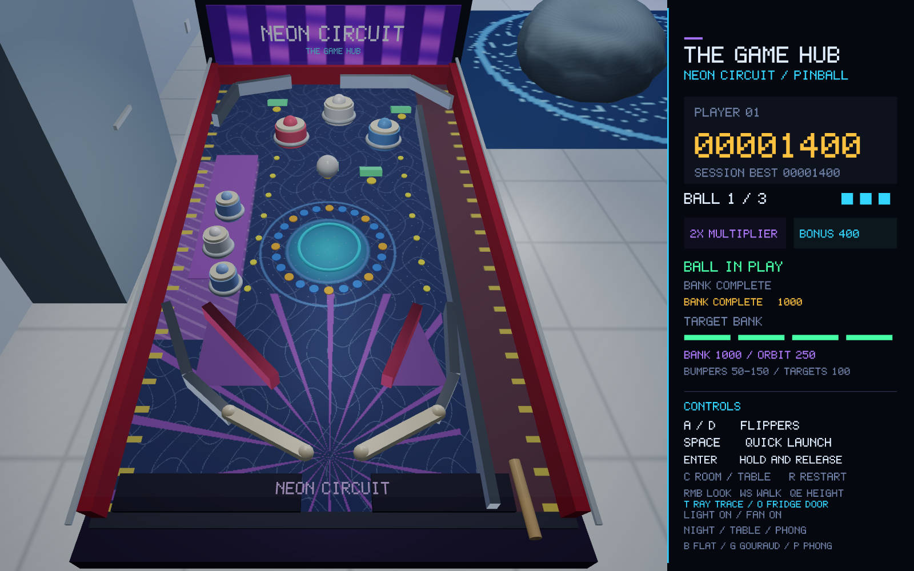](docs/screenshots/target-bank.png) |

The side slingshots kick the ball back into play for **10 base points**. An upward pass through the left orbit awards **250 base points** and adds **100 bonus**; merely sitting in the lane does not trigger the reward.

| Slingshot impact | Upward left orbit |
| --- | --- |
| [](docs/screenshots/slingshot-hit.png) | [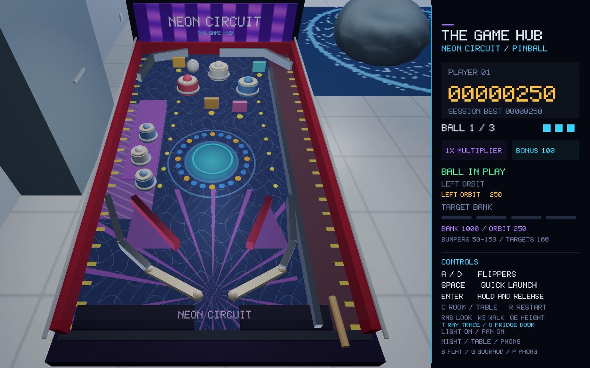](docs/screenshots/orbit-hit.png) |

### 4. Drain bonus, ball save, game over, and restart

A lost ball collects its bonus once and advances the ball counter. A single-use **eight-second ball save** protects the first launch of each ball. A game has exactly **three balls**. Restart clears score, bonus, multiplier, target state, and lives while retaining the best score from the current application session.

| Bonus collected | Early drain saved |
| --- | --- |
| [](docs/screenshots/drain-bonus.png) | [](docs/screenshots/ball-save.png) |

| Game over after three balls | Restart preserves the session best |
| --- | --- |
| [](docs/screenshots/game-over.png) | [](docs/screenshots/restart-session-best.png) |

### 5. Modeled lounge, materials, and camera exploration

The lounge includes porcelain floor tiles, a textured blue rug, gray beanbags, navy acoustic panels, blue LED borders, a TV and console table, cabinets, a beverage refrigerator, a mascot, an air conditioner, glass side panels, suspended Y/square pendants, and a separate four-blade fan. Procedural textures and material properties distinguish tile, fabric, glass, metal, and the pinball artwork.

**W / S**, the arrow keys, and **Q / E** move the camera; hold the right mouse button to look and scroll to zoom. Camera bounds keep exploration inside the room. **C** selects room/table views and **H** restores the room's reference composition.

| Reference lounge camera | Alternate exploration camera |
| --- | --- |
| [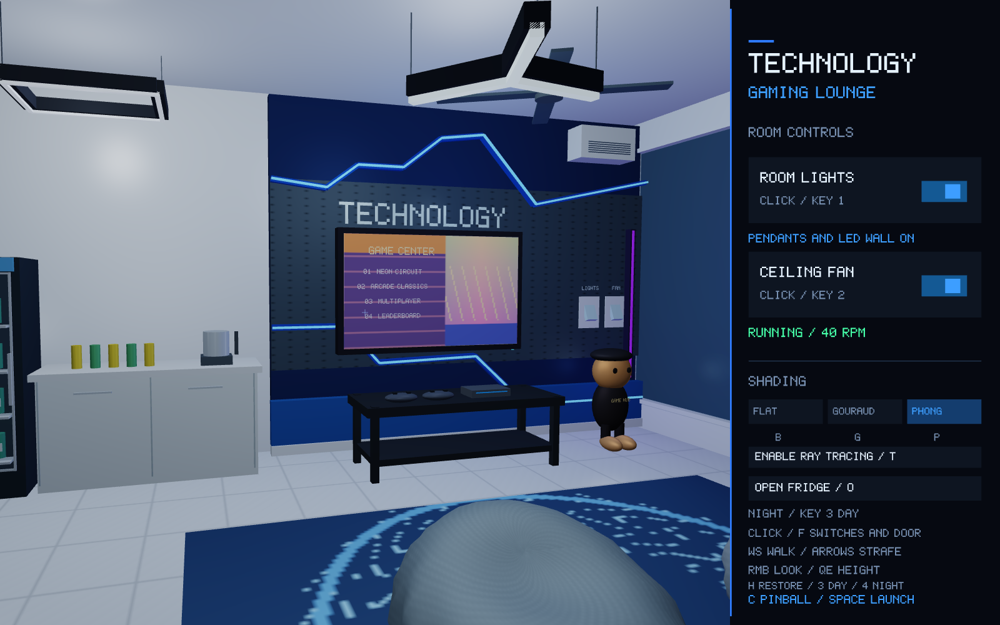](docs/screenshots/room-overview.png) | [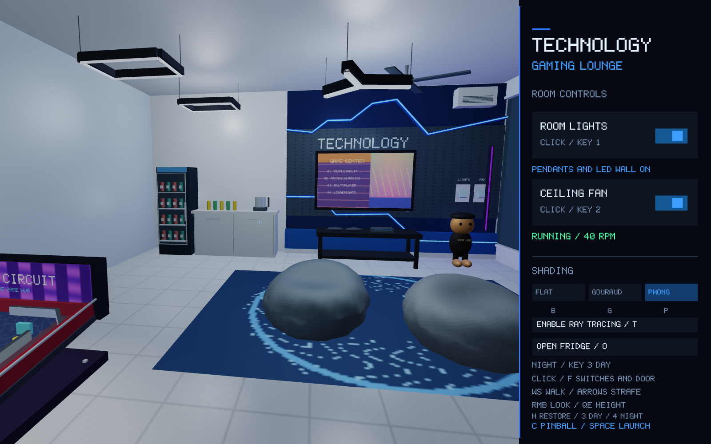](docs/screenshots/camera-exploration.png) |

### 6. Independent room lighting and day/night modes

Press **1** or use the lights control to switch the room lights. **3 / 4** select day/night ambience independently. Point lights, the table spotlight, emissive fixtures, distance attenuation, and material highlights contribute to the scene.

| Night with room lights on | Night with room lights off | Day with room lights on |
| --- | --- | --- |
| [](docs/screenshots/room-overview.png) | [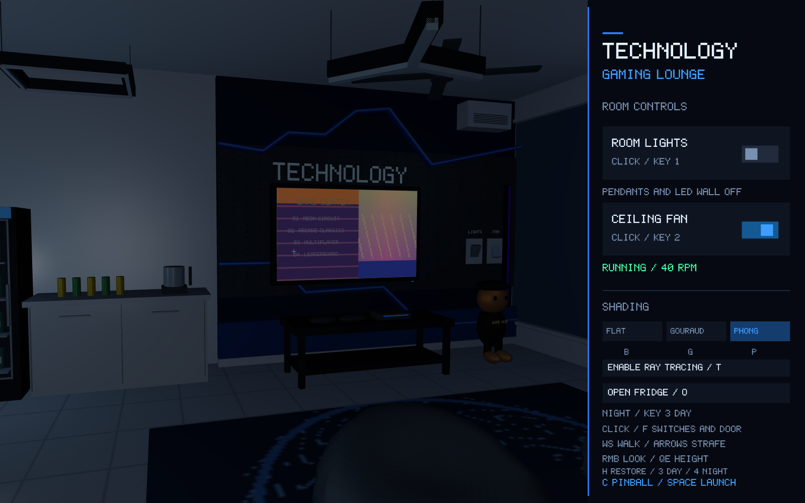](docs/screenshots/lights-off.png) | [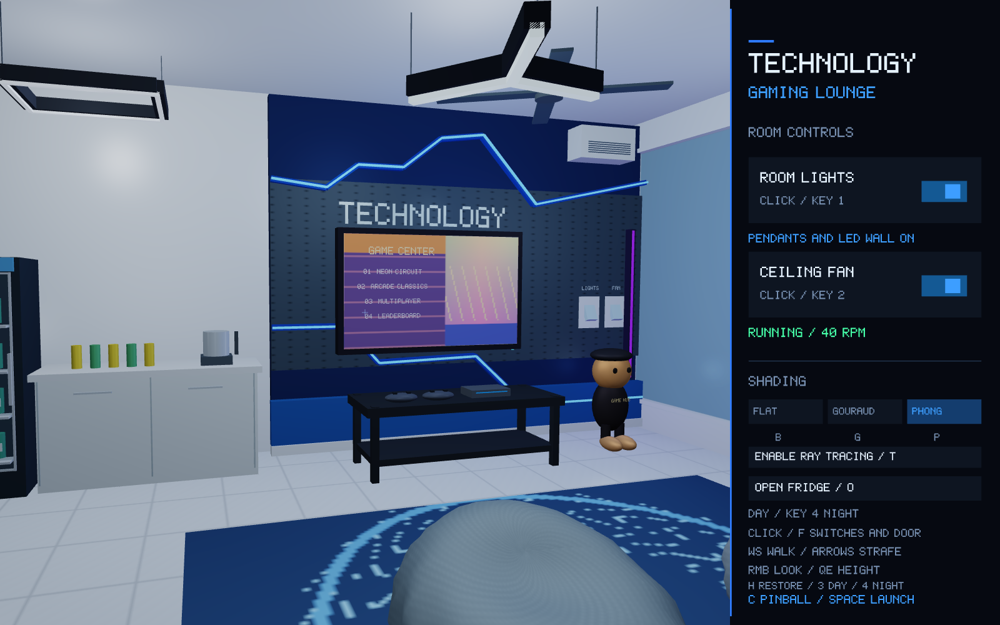](docs/screenshots/day-mode.png) |

### 7. Ceiling fan acceleration and coasting

Press **2**, click the fan console control, or use the wall rocker. The fan accelerates to **40 RPM**, continues rotating as it slows after switching off, and finally stops. Its power is independent of room lighting. The console displays its state and speed.

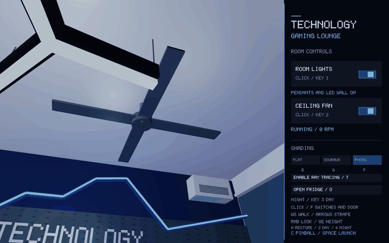

| Running fan | Fan stopped |
| --- | --- |
| [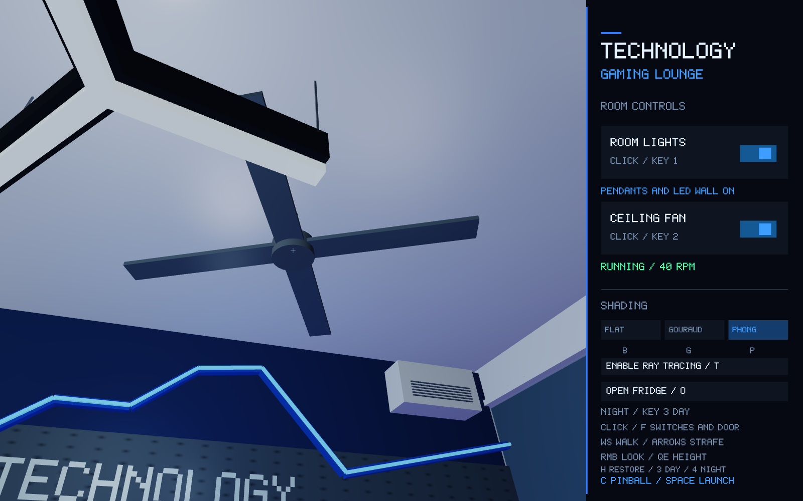](docs/screenshots/fan-running.png) | [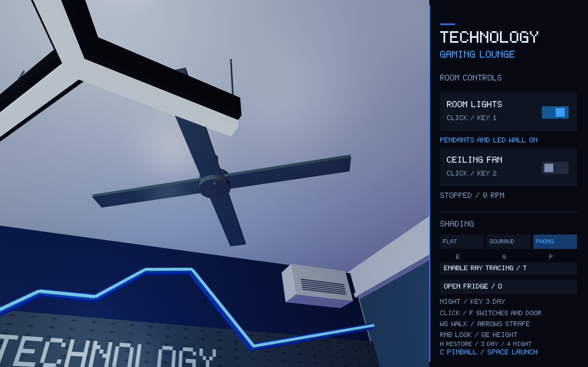](docs/screenshots/fan-stopped.png) |

### 8. Hinged refrigerator door and direction reversal

Press **O**, click the refrigerator door, or use **OPEN FRIDGE / CLOSE FRIDGE**. The glass, frame, and handle rotate together around a shared hinge. Activating the control during motion reverses its direction. The door opens to **100°**.

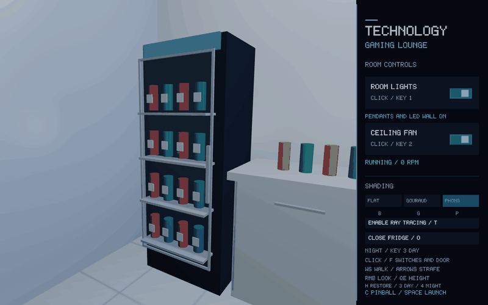

| Closed door | Fully open door |
| --- | --- |
| [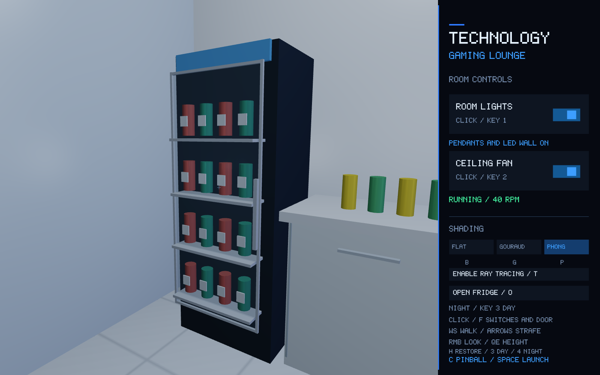](docs/screenshots/fridge-closed.png) | [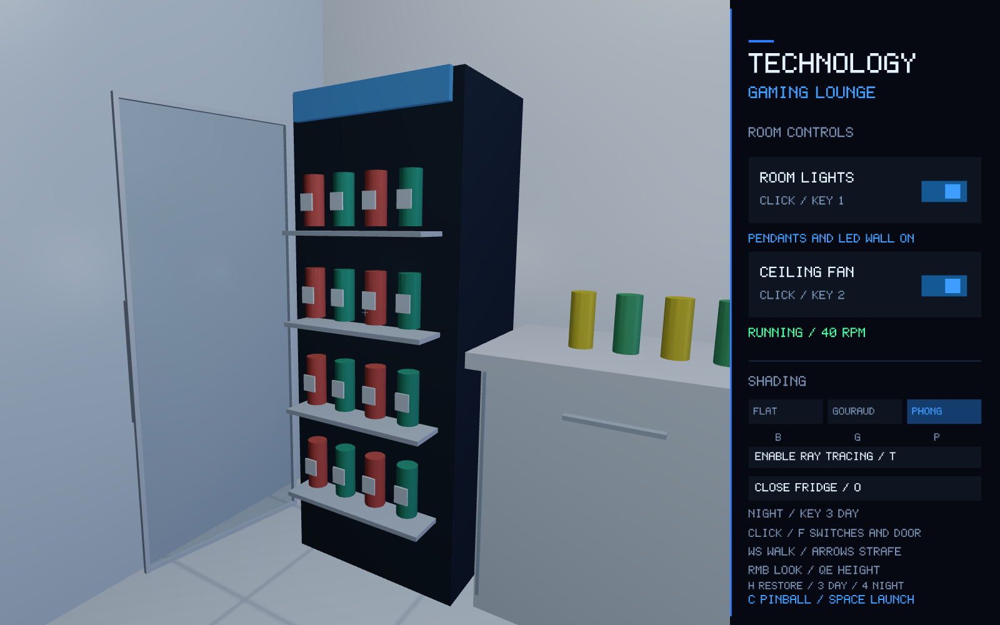](docs/screenshots/fridge-open.png) |

### 9. Clickable controls and scene picking

The room console provides clickable lights, fan, shading, ray-tracing, and door controls. The labeled wall rockers can also be clicked directly. Aim the crosshair and press **F** to use a rocker or the fridge door; selection uses a ray cast against the objects' bounds. This example shows the wall fan switch selected while the lights remain on.

[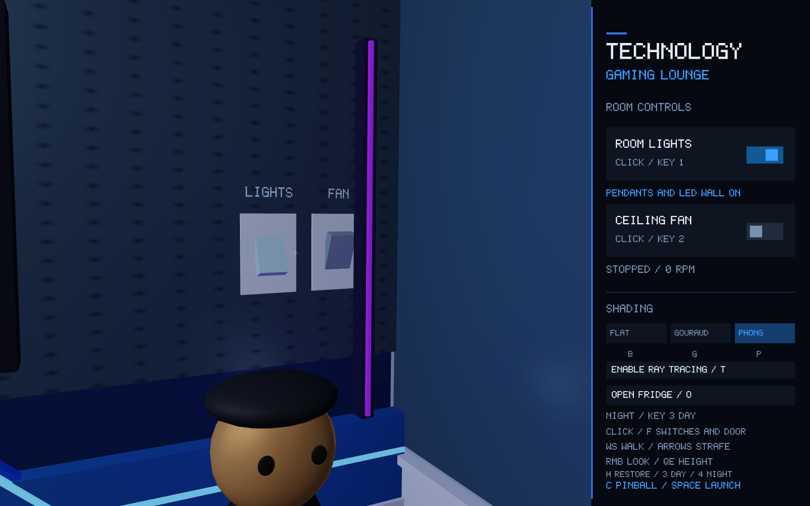](docs/screenshots/wall-switches.png)

### 10. Flat, Gouraud, and Phong shading

Press **B / G / P**, or choose a shading button in the room console. The screenshots below use the same camera and scene state.

| Flat — B | Gouraud — G | Phong — P |
| --- | --- | --- |
| [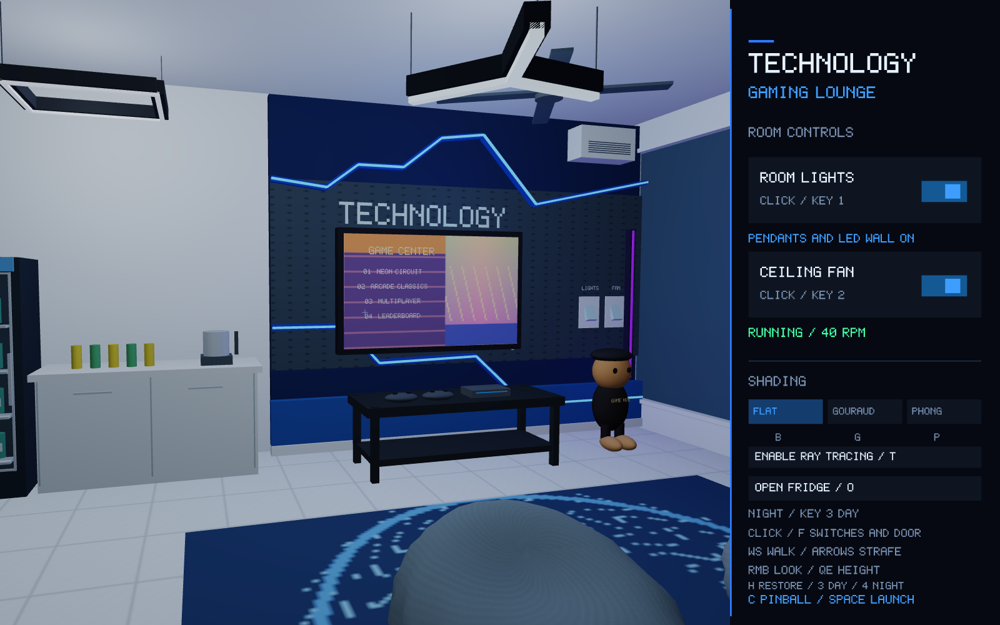](docs/screenshots/shading-flat.png) | [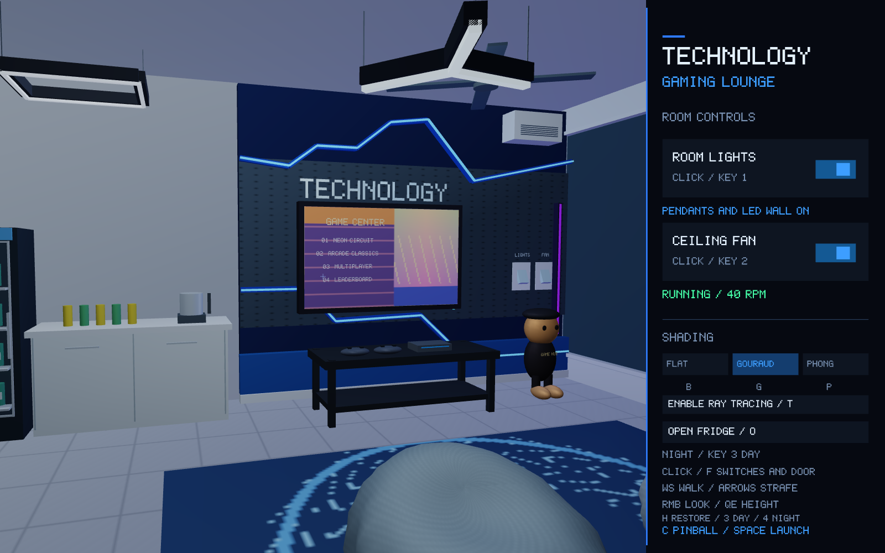](docs/screenshots/shading-gouraud.png) | [](docs/screenshots/shading-phong.png) |

**Flat** computes a face normal for faceted lighting. **Gouraud** computes lighting at vertices and interpolates the result. **Phong** interpolates normals and evaluates lighting per fragment, giving more detailed specular highlights.

### 11. Ray-traced shadows, reflections, and glass

Press **T** or click **ENABLE RAY TRACING**. The CPU ray tracer exports the visible room and table geometry into a world-space snapshot, accelerates triangle intersections with a BVH, and evaluates shadow rays, recursive mirror reflection, and dielectric glass refraction. It uses the same materials, textures, lights, and animated transforms as the raster scene.

| Full room with reflected floor detail | Transparent refrigerator glass |
| --- | --- |
| [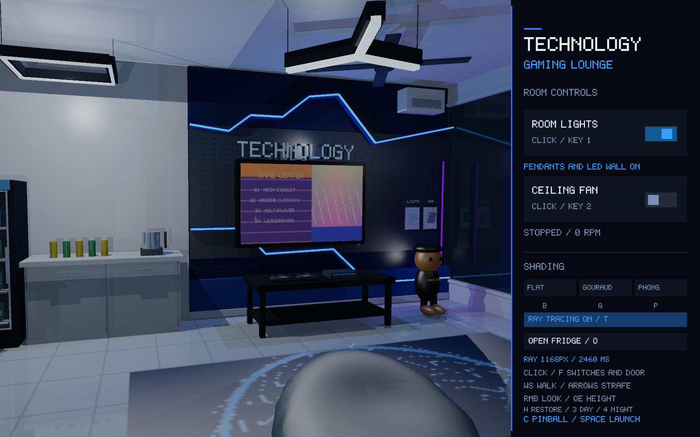](docs/screenshots/room-raytrace.png) | [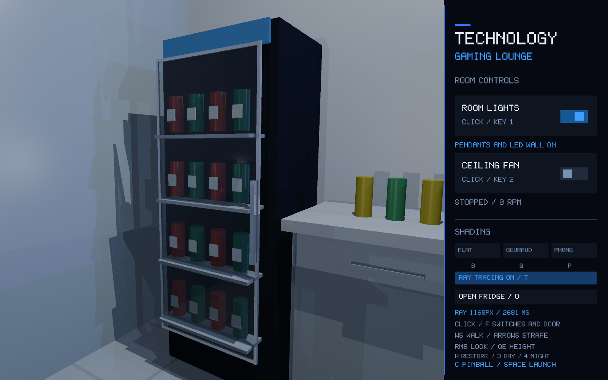](docs/screenshots/glass-raytrace.png) |

The pinball table is included in ray tracing, including its metal ball, glass cover, decorative lights, and backglass.

[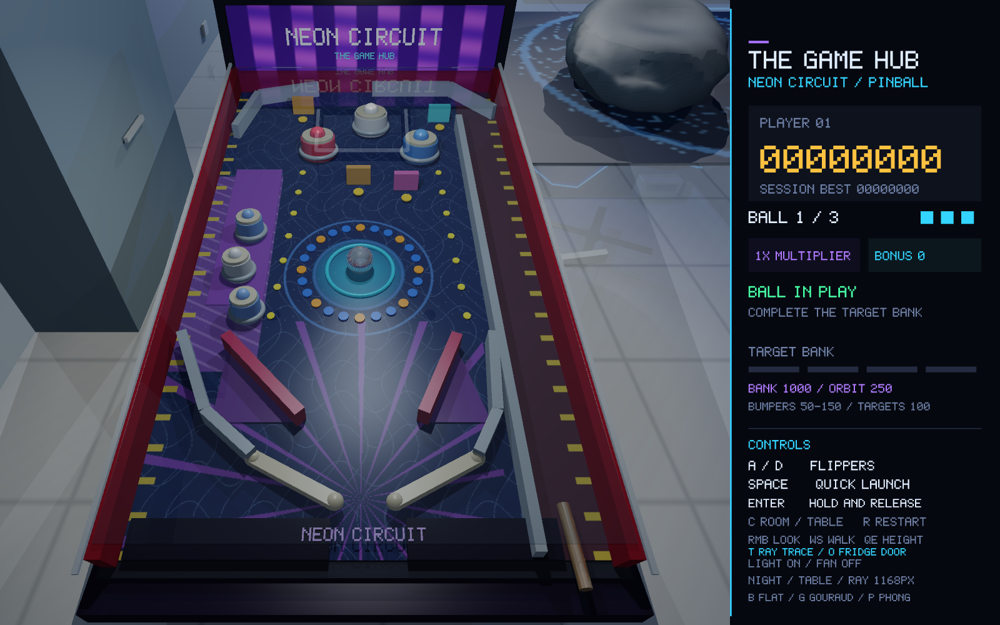](docs/screenshots/table-raytrace.png)

Live rendering starts with a **480-pixel preview**, refines through **960 pixels**, and reaches a default **1280-pixel image with two samples per pixel**, subject to viewport and image-budget limits. Active pinball uses up to **640 pixels and one sample** for more frequent updates. Camera/door movement temporarily displays raster rendering while a new ray image is prepared. Static, fully refined views stop requesting new renders until the scene changes.

## Controls

| Area | Key / input | Action |
| --- | --- | --- |
| Pinball | Space | Quick-launch a waiting ball |
| Pinball | Enter / keypad Enter | Hold to charge; release to launch |
| Pinball | A / D | Left / right flipper |
| Pinball | R | Restart the game; retain the session best score |
| Camera | C | Switch room and table cameras |
| Camera | H | Restore the reference room camera and select room view |
| Camera | W / S | Move forward / backward |
| Camera | Left / right arrows | Strafe |
| Camera | Q / E | Move up / down |
| Camera | Right mouse, held | Look around |
| Camera | Mouse wheel | Zoom |
| Room | 1 | Toggle room lights |
| Room | 2 | Toggle ceiling fan |
| Room | 3 / 4 | Day / night ambience |
| Room | O | Open / close fridge; reverse its motion |
| Room | Left click | Use console buttons, wall rockers, or the fridge door |
| Room | F | Use a switch or door at the crosshair |
| Rendering | B / G / P | Flat / Gouraud / Phong raster shading |
| Rendering | T | Toggle ray tracing |
| Application | Escape | Exit |

The rendering shortcuts use ordinary letter keys; no function-key modifier is required. **B / G / P** also return to raster rendering when ray tracing is active.

## Scoring and game flow

| Event | Base score | Added end-of-ball bonus |
| --- | ---: | ---: |
| Left / right main pop bumper | 100 | 10 |
| Upper middle pop bumper | 150 | 10 |
| Small side bumper | 50 | 10 |
| Drop target | 100 | 50 |
| Slingshot | 10 | 0 |
| Left orbit, traveled upward from the side lane | 250 | 100 |
| Complete all four drop targets | 1,000 | 0 |

The current multiplier applies to scoring events. Completing the target bank increases it by one, up to **5×**. Flippers and ordinary walls award no points, and contact cooldowns prevent repeated points from a single impact.

**Worked example:** at 1×, four targets award `4 × 100 + 1,000 = 1,400` points. They accumulate `4 × 50 = 200` bonus and advance the multiplier to 2×. On a lost ball, the bonus becomes `200 × 2 = 400`, giving **1,800 total points** before ball two. The corresponding states appear in the target-bank and drain-bonus screenshots above.

A waiting ball remains in the shooter lane. A launch moves through the shooter state into play. A drain either consumes the available ball save or collects the bonus and advances to the next ball. Bonus and multiplier reset on a lost ball; a saved ball preserves them. After three lost balls, launches and scoring stop until **R** restarts the game.

The session best score survives restarts and resets when the application closes. It is not saved to disk.

## Graphics implementation

| Computer graphics topic | Implementation | Main source |
| --- | --- | --- |
| Geometry and textures | Cubes, planes, spheres, cylinders, rings, springs, text meshes, deformed beanbag geometry, procedural texture sampling | [Mesh.cpp](src/Mesh.cpp), [GameHub.cpp](src/GameHub.cpp) |
| Transformations | Translation, Euler-angle rotation converted to quaternions, nonuniform scale, parent placement of the pinball machine, shared refrigerator hinge | [Transform.cpp](src/Transform.cpp), [GameHub.cpp](src/GameHub.cpp) |
| Normal transformation | Inverse-transpose normal matrices for transformed geometry | [phong.vert](shaders/phong.vert), [RayTracer.cpp](src/RayTracer.cpp) |
| Lighting | Attenuated point lights, cone-falloff spotlight, ambient/day-night lighting, specular materials, emissive surfaces, tone mapping | [Light.h](include/Light.h), [GameHub.cpp](src/GameHub.cpp) |
| Flat shading | Face normals derived in the fragment shader | [flat.frag](shaders/flat.frag) |
| Gouraud shading | Lighting evaluated per vertex and interpolated | [gouraud.vert](shaders/gouraud.vert), [gouraud.frag](shaders/gouraud.frag) |
| Phong shading | Interpolated normals; lighting evaluated per fragment | [phong.vert](shaders/phong.vert), [phong.frag](shaders/phong.frag) |
| Animation | Fixed-step ball motion, powered flippers, plunger pull, target motion, fan acceleration/coasting, hinged door | [PinballMachine.cpp](src/PinballMachine.cpp), [GameHub.cpp](src/GameHub.cpp) |
| Picking | Ray/bounds intersections for wall switches and the door; screen-space hit tests for console buttons | [GameHub.cpp](src/GameHub.cpp), [HUD.cpp](src/HUD.cpp), [main.cpp](src/main.cpp) |
| Ray tracing | Triangle BVH with twelve-bin surface-area splits, shadow segments, mirror reflection, Snell refraction, Fresnel reflectance, total internal reflection | [RayTracer.cpp](src/RayTracer.cpp) |
| Progressive presentation | Background workers, cancellation of obsolete jobs, quality refinement, OpenGL image presentation and HUD | [RayTraceView.cpp](src/RayTraceView.cpp) |

The ray tracer is a CPU Whitted-style renderer, with recursion limited to six secondary levels and a 0.5% contribution cutoff. Immutable snapshots keep worker threads separate from mutable game objects and OpenGL state. Up to eight workers are used, with one logical CPU left available on smaller machines for input and physics.

Algorithm references: [BVH acceleration](https://www.pbr-book.org/4ed/Primitives_and_Intersection_Acceleration/Bounding_Volume_Hierarchies) and [specular reflection/transmission](https://www.pbr-book.org/4ed/Reflection_Models/Specular_Reflection_and_Transmission) in *Physically Based Rendering*.

## Build and test

```bash
cmake -S . -B build -DCMAKE_BUILD_TYPE=Release -DBUILD_TESTING=ON
cmake --build build --parallel 4
ctest --test-dir build --output-on-failure
```

| CTest suite | Coverage |
| --- | --- |
| `pinball_physics` | Twelve launch power/frame-rate combinations, charged launch, fixed-step motion, ball saves, scoring cooldowns, target-bank reward, drain bonus, three-ball accounting, game over, restart, and powered flipper contacts |
| `arena_controls` | Independent switches, scene picking, fan acceleration/stopping, camera bounds, console scaling, door opening/closing/reversal, and room/pinball compatibility |
| `raytracing` | BVH intersections checked against an exhaustive reference, transformed normals, camera rays, finite shadows, transparent shadows, mirror reflection, Snell/Fresnel behavior, total internal reflection, texture filtering, threaded determinism, and animated snapshots |

All three suites run without an OpenGL window. The Release build and all three suites passed during repository verification; the gallery was also rendered and visually inspected.

## Project structure

```text
PinballGame_Computer_Graphics/
├── CMakeLists.txt                # Application/core library/test targets
├── Launch Game.command          # macOS build-and-run launcher
├── src/                         # Gameplay, room, rendering, input, and HUD
├── include/                     # Public types and interfaces
├── shaders/                     # Flat/Gouraud/Phong, HUD, ray presentation
├── external/glad/               # Bundled OpenGL loader
├── tests/                       # Three regression suites
├── docs/
│   ├── screenshots/             # 27 feature captures and an overview
│   ├── media/                   # Full video, two excerpts, three GIFs
│   └── MEDIA_GUIDE.md            # Media provenance and feature coverage
├── Reports_Graphics_Project/    # Final report and presentation artifacts
└── Interactive_3d_Pinball_Game_Report.pdf
```

Generated build directories, temporary captures, local backups, and earlier presentation drafts are excluded from the published source tree.

## Reproduce rendered captures

The application exports **PPM** images from a hidden OpenGL window. The scene still requires access to a graphics context. Captures advance the simulation at a fixed 60 FPS; pinball physics retains its internal 240 Hz step.

```bash
# Default room and active pinball
./build/GameHubPinball --capture /tmp/room.ppm --frames 120 --room
./build/GameHubPinball --capture /tmp/table.ppm --frames 100 --table --launch

# Lighting and shading comparisons
./build/GameHubPinball --capture /tmp/off.ppm --frames 100 --room --lights-off --fan-off
./build/GameHubPinball --capture /tmp/day.ppm --frames 100 --room --day
./build/GameHubPinball --capture /tmp/flat.ppm --frames 100 --room --shading flat
./build/GameHubPinball --capture /tmp/gouraud.ppm --frames 100 --room --shading gouraud
./build/GameHubPinball --capture /tmp/phong.ppm --frames 100 --room --shading phong

# Ray-traced room, open door, and pinball
./build/GameHubPinball --capture /tmp/rays.ppm --frames 90 --room --raytrace --ray-width 960 --ray-samples 4
./build/GameHubPinball --capture /tmp/open.ppm --frames 90 --room --door-open --raytrace
./build/GameHubPinball --capture /tmp/table-rays.ppm --frames 100 --table --launch --raytrace
```

| Option | Meaning |
| --- | --- |
| `--capture PATH` | Save a PPM frame and exit after the requested simulation frames |
| `--frames N` | Number of simulated capture frames; default 60 |
| `--room` / `--table` | Select the initial camera; `--launch` also selects the table |
| `--launch` | Launch the waiting ball automatically |
| `--lights-off` / `--fan-off` | Disable the corresponding room control |
| `--day` | Use day ambience; night is the default |
| `--door-open` | Start opening the fridge door |
| `--shading flat\|gouraud\|phong` | Select raster shading; `raytrace` is also accepted as an alias for ray tracing |
| `--raytrace` | Enable ray tracing |
| `--ray-width N` | Ray-image width, clamped to 64–1920 pixels |
| `--ray-samples N` | Samples per pixel, clamped to 1–64 |
| `--capture-live` | Capture after the asynchronous renderer reaches the requested final quality |

Synchronous ray captures default to **480 pixels wide with four samples per pixel** and render the final simulated scene for reproducible output. Live default quality is chosen separately. Explicit `--ray-width` and `--ray-samples` also configure final live refinement, for example:

```bash
./build/GameHubPinball --ray-width 1920 --ray-samples 4
```

Higher ray quality increases CPU rendering time. Shaders are copied beside the executable during configuration/build, so launching the built executable from another working directory also works.

## Project reports

| Artifact | Link |
| --- | --- |
| Full project report | [PDF](Interactive_3d_Pinball_Game_Report.pdf) |
| Condensed report | [PDF](Reports_Graphics_Project/Interactive_3d_Pinball_Game_Report_Condensed.pdf) · [Word document](Reports_Graphics_Project/Interactive_3d_Pinball_Game_Report_Condensed.docx) |
| Final presentation with updated textures | [PowerPoint](Reports_Graphics_Project/Interactive3D_Pinball_Game_Presentation_Updated_Textures.pptx) |
| Screenshot/video coverage and sources | [Media guide](docs/MEDIA_GUIDE.md) |

## Practical limits and troubleshooting

- **Build cannot find GLFW or GLM:** install the dependencies, then rerun CMake. A package-manager prefix can be supplied with `-DCMAKE_PREFIX_PATH=/path/to/prefix` when needed.
- **Window/context creation fails:** run from a desktop graphics session with OpenGL 3.3 core support. The headless regression suites remain available without a window.
- **Ray tracing takes time to refine:** keep the camera still and watch the displayed ray-image width. Reduce `--ray-width` or `--ray-samples` for faster updates.
- **Score disappears after quitting:** the best score is intentionally session-only and has no persistence layer.

The ray tracer uses direct illumination plus recursive mirror/glass transport. Ambient light approximates diffuse indirect illumination; diffuse global illumination, rough-reflection sampling, nested dielectric media, and hardware ray-tracing APIs are outside its scope. Separate glass solids are modeled as surrounded by air.

Maintained by [@nahianzarif1](https://github.com/nahianzarif1).
